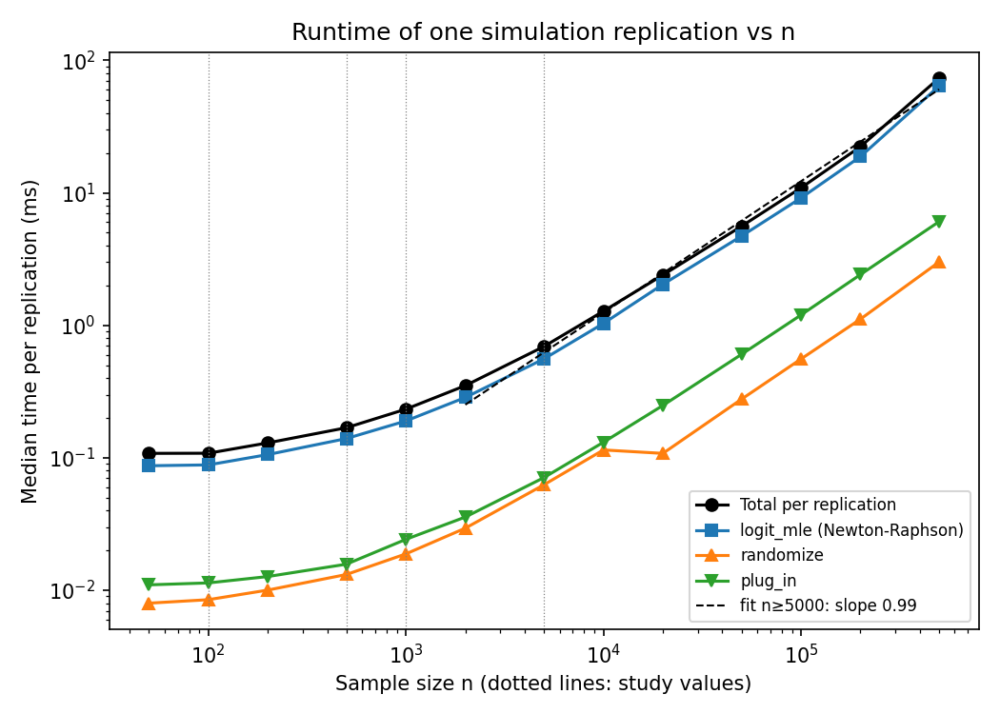
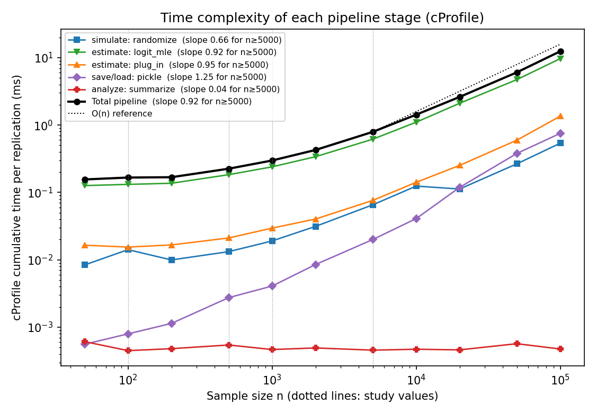

# Baseline Performance: Unit 2 Simulation Study

This document records how the simulation study ran **as submitted for Unit 2**, before any optimization. `src/` is unchanged. All measurements come from the scripts in `profiling/` (`make profile`), and their raw output is in `results/profiling/`.

**Machine and software.** Apple M1 (8 cores, 16 GB RAM), macOS (Darwin 27.2), Python 3.9.6, NumPy 2.0.2, matplotlib 3.9.4, line_profiler 5.0.2. Everything runs single-threaded. Timings are wall-clock medians unless stated otherwise.

**Study settings.** n ∈ {100, 500, 1000, 5000} with S = 1000 randomized experiments per n, giving 4000 logistic regressions fit by Newton–Raphson plus 4000 plug-in estimates. Seed 607.

---

## 1. Total runtime

| Run | `make clean && make all` wall time |
|---|---|
| 1 | 3.88 s |
| 2 | 3.53 s |
| 3 | 3.57 s |

**The full study takes about 3.6 s end to end.** The README's figure of about 5 s is a conservative upper bound.

Breakdown by `make` stage (fresh interpreter for each, median of 3, from `results/profiling/stage_timings.csv`):

| Stage | Script | Wall time | Share |
|---|---|---|---|
| simulate | `src/simulation.py` (generate, pickle, reload, estimate, pickle) | 1.55 s | 44% |
| analyze | `src/analyze.py` | 0.18 s | 5% |
| figures | `plot_plugin.py` + `plot_beta2.py` | 0.90 + 0.89 s | 51% |
| *for reference* | `import numpy` alone | 0.16 s | |
| *for reference* | `import matplotlib.pyplot` alone | 0.54 s | |

About half the wall time goes to plotting, and most of that is fixed cost: each of the two plot scripts imports matplotlib (0.54 s) and loads the 106 MB `simulated.pk` only to read `delta`. Neither cost depends on the statistics. The scientific computation is entirely inside the **simulate** stage, and that stage is what the rest of this document profiles.

## 2. Profiler results

### 2.1 cProfile of `simulation.py` (function level)

The run took 1.60 s under cProfile (`results/profiling/cprofile_simulation.txt`, with the `.prof` file alongside it for snakeviz).

| Function | Calls | Own time | Cumulative time | % of run |
|---|---|---|---|---|
| `simulation.estimate` | 1 | 0.008 s | **1.378 s** | **86%** |
| ↳ `methods.logit_mle` | 4,000 | 0.655 s | **1.221 s** | **76%** |
| ↳↳ `methods._expit` | 32,352 | 0.336 s | 0.336 s | 21% |
| ↳↳ `numpy.linalg.solve` (3×3) | 24,352 | 0.096 s | 0.219 s | 14% |
| ↳ `methods.plug_in` | 4,000 | 0.025 s | 0.148 s | 9% |
| `simulation.simulate_data` | 1 | 0.015 s | 0.157 s | 10% |
| ↳ `dgps.randomize` | 4,000 | 0.091 s | 0.115 s | 7% |
| `pickle.dump` + `pickle.load` | 3 | 0.062 s | 0.062 s | 4% |

24,352 Newton iterations across 4,000 fits works out to **6.1 iterations per fit**. One call to `np.linalg.solve` on a 3×3 system costs about 9 µs. Almost all of that is Python and NumPy dispatch overhead (`_commonType`, `_makearray`, error-state context managers): the 3×3 solve itself takes nanoseconds.

### 2.2 line_profiler on the hot path

From `results/profiling/line_profile.txt`, `methods.logit_mle` (1.30 s total under the line profiler):

| Line | Code | % of `logit_mle` |
|---|---|---|
| 20 | `hess = (M * (p * (1 - p))[:, None]).T @ M` | **25.7%** |
| 18 | `p = _expit(M @ beta)` | **23.9%** |
| 21 | `step = np.linalg.solve(hess, grad)` | **21.6%** |
| 19 | `grad = M.T @ (Y - p)` | 17.2% |
| 23 | `if np.max(np.abs(step)) < tol` | 7.4% |
| 15 | `M = np.column_stack([...])` | 2.9% |

In `dgps.randomize`, 80% of the time is `rng.choice(n, size=nT, replace=False)`. In `plug_in`, the time splits evenly between its two `_expit(...).mean()` calls.

**Main bottlenecks, in order:**

1. **The Newton–Raphson loop in `logit_mle`, at about 76–80% of compute.** The time is spread fairly evenly over its four array operations. No single line dominates, which suggests the cost is mostly per-call overhead repeated about 24k times.
2. **`plug_in` and `randomize`, at about 7–10% each.** Both are O(n) array work plus per-call overhead.
3. **Pickle I/O plus the duplicated loads and imports in the figure scripts.** These cost little compute but a lot of wall time in `make all`.

## 3. Computational complexity

### 3.1 Theoretical analysis

Notation: n is the sample size, p = 3 is the number of logit parameters, S = 1000 is the number of replications per n, and K is the number of Newton iterations.

| Step | Work per replication | Notes |
|---|---|---|
| `make_population` (once per n) | O(n) | negligible |
| `randomize` | O(n) | `choice` without replacement, then elementwise Y |
| `logit_mle`, per iteration | O(np) for `M@β`, expit and gradient; O(np²) for the Hessian; O(p³) for the solve | |
| `logit_mle`, total | **O(K·n·p²)** | p = 3 is fixed and K ≈ 6 does not depend on n (see 3.2), so this is **O(n)** |
| `plug_in` | O(n) | two expit evaluations and two means |
| `true_delta` (once per n) | O(n) | |

So **one replication costs Θ(n)**, and the whole study costs Θ(S · Σ n) = Θ(1000 × 6600). Newton–Raphson converges quadratically once it is near the optimum, and the log-likelihood here is well conditioned (Hessian condition number < 90; see Section 4). That is why K does not grow with n: the measured K is 6.0 for every n ≥ 500 and 6.35 at n = 100.

Asymptotics alone miss an important fact: each replication makes several dozen small NumPy calls, and each call has a fixed overhead of a few microseconds that does not depend on n. A better model is

  **t(n) ≈ a + b·n,  with a ≈ 0.105 ms and b ≈ 0.114 µs per observation.**

This was fit to the measured data for 50 ≤ n ≤ 200,000 and has a maximum relative error of 7%. The overhead term and the linear term are equal at **n ≈ 900**.

### 3.2 Empirical analysis

`profiling/complexity.py` times a single replication (randomize, then `logit_mle`, then `plug_in`) on a frozen population for n from 50 to 500,000. It reports the median over 30 to 1000 repetitions. Full data is in `results/profiling/complexity.csv`.



| n | randomize | logit_mle | plug_in | **total** | Newton iters |
|---|---|---|---|---|---|
| 100 | 0.009 ms | 0.088 ms | 0.011 ms | **0.108 ms** | 6.1 |
| 500 | 0.013 ms | 0.140 ms | 0.016 ms | **0.169 ms** | 6.0 |
| 1,000 | 0.019 ms | 0.190 ms | 0.024 ms | **0.233 ms** | 6.0 |
| 5,000 | 0.063 ms | 0.558 ms | 0.071 ms | **0.693 ms** | 6.0 |
| 50,000 | 0.277 ms | 4.716 ms | 0.604 ms | **5.597 ms** | 6.0 |
| 500,000 | 3.007 ms | 63.96 ms | 6.063 ms | **73.42 ms** | 6.0 |

Slopes fitted on a log–log scale (`results/profiling/complexity_fit.txt`):

| Component | n ≤ 1000 | n ≥ 5000 | all n |
|---|---|---|---|
| `logit_mle` | 0.27 | **1.01** | 0.72 |
| `plug_in` | 0.25 | 0.97 | 0.72 |
| `randomize` | 0.28 | 0.83 | 0.65 |
| **total** | **0.26** | **0.99** | 0.72 |

The empirical results match the theory: the cost is **linear in n (slope ≈ 1.0)** once n is above a few thousand. In the range the study actually uses (n ≤ 1000), the slope is only about 0.26, because fixed per-call overhead dominates. The study's n are marked by dotted lines on the plot, and three of the four fall in this overhead-dominated region. At 500k the curve bends slightly upward, likely because of cache effects (the arrays no longer fit in cache). `randomize` has a kink near n = 20k, where NumPy's `choice(replace=False)` switches between sampling algorithms.

**Where the study's compute goes**, predicted as 1000 × t(n) from the table above:

| n | Predicted time for 1000 reps | Share |
|---|---|---|
| 100 | 0.11 s | 9% |
| 500 | 0.17 s | 14% |
| 1,000 | 0.23 s | 19% |
| 5,000 | 0.69 s | 58% |
| **Total** | **1.20 s** | |

This agrees with the 1.38 s measured by cProfile for `estimate`, which includes profiler overhead. Under the a + b·n model, about **35% of all compute (4000 × a ≈ 0.42 s) is pure per-replication overhead.** For this workload, the most promising optimization is therefore to vectorize across the S replications (fit all 1000 regressions for a given n in one batched Newton loop), which cuts overhead from O(S) calls to O(1), rather than to speed up the O(n) arithmetic.

### 3.3 Per-stage scaling measured by the profiler

`profiling/profile_stages.py` runs the whole Unit 2 pipeline under cProfile for one sample size at a time: `simulate_data`, then the pickle save and reload, then `estimate`, then `analyze.summarize`. It does this for n from 50 to 100,000, with S = 200 replications at every n. Each stage's cumulative time is read from the profile and divided by S. Data is in `results/profiling/stage_scaling.csv` and the fitted slopes are in `stage_scaling_fit.txt`.



cProfile cumulative time per replication, in ms:

| Stage | n = 100 | n = 500 | n = 1,000 | n = 5,000 | n = 100,000 | Slope, n ≤ 1000 | Slope, n ≥ 5000 |
|---|---|---|---|---|---|---|---|
| simulate: `randomize` | 0.014 | 0.013 | 0.019 | 0.066 | 0.538 | 0.21 | 0.66 |
| estimate: `logit_mle` | 0.132 | 0.184 | 0.240 | 0.617 | 9.681 | 0.21 | **0.92** |
| estimate: `plug_in` | 0.015 | 0.021 | 0.030 | 0.076 | 1.354 | 0.20 | 0.95 |
| save/load: pickle | 0.001 | 0.003 | 0.004 | 0.020 | 0.753 | 0.69 | **1.25** |
| analyze: `summarize` | 0.0004 | 0.0005 | 0.0005 | 0.0005 | 0.0005 | −0.04 | 0.04 |
| **Total pipeline** | **0.166** | **0.225** | **0.298** | **0.792** | **12.43** | 0.21 | 0.92 |

The per-stage results agree with the analysis in 3.1:

- **`logit_mle` dominates at every n,** taking 75–80% of each replication. It is overhead-bound below n ≈ 1000 (slope about 0.2) and close to linear above that.
- **`plug_in` and `randomize` are O(n)** with small constants. `randomize` has a slope of only 0.66 because of the NumPy `choice` algorithm switch near n = 20k (also visible in 3.2).
- **Pickle save/load is the only stage that grows faster than linearly** (slope about 1.25). It copies S × n int64 arrays, and once those buffers get large, memory allocation and copying cost more per byte. It is negligible at the study's n, about 2.5% of the total at n = 5000, but rises to 6% at n = 100,000. In the real `simulation.py`, which writes a 106 MB file to disk, it took 0.06 s (Section 2.1).
- **`summarize` does not depend on n.** It works on the S × 7 estimates array, so its cost is O(S × number of sample sizes).

The profiler's own per-call overhead inflates the small-n times. At n = 100 the total is 0.166 ms under cProfile versus 0.108 ms measured directly in 3.2. This also pulls the n ≥ 5000 slope down to about 0.92, from 0.99 without the profiler. Use 3.2 for absolute times and this figure for how the stages compare and how each one scales.

### 3.4 Scaling in the other parameters

- **S (replications):** exactly linear. The replications are independent and run in a plain Python loop.
- **Memory:** `simulate_data` stores X and Y for every replication as int64 arrays of shape S × n. That totals 2 × 1000 × 6600 × 8 B ≈ **106 MB** (traced peak 108.5 MB, and `data/simulated.pk` is 106 MB on disk). Memory is Θ(S·Σn). The values are only 0 or 1, so `int8` or `bool` would need about 13 MB. Generating each replication inside the estimation loop instead of storing them all would need O(n) memory.

## 4. Numerical warnings and convergence

`profiling/stability.py` re-runs the study exactly (seed 607) and logs the following for each replication:

- every NumPy floating-point event (overflow, divide-by-zero, invalid and underflow, counted with `np.errstate(all="call")`)
- every Python warning
- every exception

It also replays the Newton loop to record iterations, convergence, gradient size, Hessian condition number and the range of fitted probabilities. The replay reproduces `logit_mle` exactly, bit for bit, in all 4000 replications. Output is in `results/profiling/stability_log.txt` and `stability_study_n*.csv`.

### 4.1 The Unit 2 study: no instability observed

| n | Exceptions | Warnings / FP events | Not converged | Newton iters (mean / max) | max \|∇ℓ\| at solution | Hessian cond. (max) | Fitted p range | max \|β̂\| |
|---|---|---|---|---|---|---|---|---|
| 100 | 0 | 0 | 0 / 1000 | 6.35 / 7 | 9.0e-15 | 88 | [0.009, 0.994] | 7.5 |
| 500 | 0 | 0 | 0 / 1000 | 6.00 / 6 | 3.0e-14 | 42 | [0.105, 0.959] | 3.7 |
| 1,000 | 0 | 0 | 0 / 1000 | 6.00 / 6 | 5.8e-14 | 42 | [0.104, 0.963] | 4.1 |
| 5,000 | 0 | 0 | 0 / 1000 | 6.00 / 6 | 3.1e-13 | 37 | [0.132, 0.953] | 3.7 |

**No warnings, exceptions, non-finite estimates or convergence failures occurred in any of the 4000 replications, and no floating-point events were raised, not even underflow.** Every fit met the step tolerance of 1e-10 in at most 7 iterations, with a gradient at machine-precision level. The plug-in α̂_T and α̂_C always stayed well inside (0, 1), with all values in [0.17, 0.75], so the log-odds in `plug_in` and `true_delta` were never near 0 or ±∞. No experiment had a treatment arm with a constant outcome, so there was no separation. The smallest arm is 25 controls at n = 100.

n = 100 is the only setting with any sign of strain: it has the widest range of fitted probabilities and the largest coefficients (|β̂| up to 7.5), and it occasionally needs a 7th iteration. That is expected, since it is the smallest sample.

### 4.2 Stress test: where the same code breaks

To find the conditions under which the code becomes unstable, the same functions were run at smaller n. Each n uses 10 populations × 100 randomizations, frac_treated = 0.75 and seed 2026.

| n | Arm with constant Y (separation) | `LinAlgError: Singular matrix` | Hit `max_iter=100` silently | Non-finite δ̃ | Overflow events (`exp`) | Divide-by-zero (`log`) | Total failures |
|---|---|---|---|---|---|---|---|
| 8 | 59.9% | 68.5% | 1.1% | 1.0% | 470 | 10 | **70.6%** |
| 12 | 27.7% | 39.4% | 1.5% | 0.6% | 5153 | 6 | **41.5%** |
| 16 | 15.6% | 15.0% | 0 | 0.8% | 206 | 8 | **15.8%** |
| 20 | 9.3% | 9.0% | 0.2% | 0.2% | 145 | 2 | **9.4%** |
| 30 | 1.7% | 1.5% | 0 | 0.2% | 1 | 2 | **1.7%** |
| 50 | 0.1% | 0.1% | 0 | 0 | 0 | 0 | **0.1%** |
| ≥ 100 (study) | 0 | 0 | 0 | 0 | 0 | 0 | **0** |

The cause is **(quasi-)complete separation.** When the control arm (only 25% of subjects) happens to have all Y = 0 or all Y = 1, the logit MLE does not exist (β̂ → ±∞). Newton then pushes fitted probabilities to exactly 0 or 1, the weights p(1 − p) underflow to zero, and the Hessian becomes singular. The simple constant-arm check explains 100% of failures at n ≥ 30 and 83% at n = 8. The remainder are separation through Z, or through X and Z jointly, which this check does not detect.

The symptoms and how they would surface under NumPy's default error settings:

- **`np.linalg.LinAlgError: Singular matrix`** from `solve`. This is the most common symptom. It is uncaught, so it would crash `simulation.py` mid-study.
- **`RuntimeWarning: overflow encountered in exp`** in `_expit`, once |Mβ| > 709. The naive `1/(1+exp(-t))` loses all precision there.
- **Silent non-convergence.** `logit_mle` stops after `max_iter = 100` and returns β̂ with no flag or warning. Values as large as |β̂| ≈ 1e141 were returned this way.
- **`RuntimeWarning: divide by zero encountered in log`** in `plug_in`, when α̂_C rounds to exactly 0 or 1. This gives δ̃ = ±∞.
- **Hessian condition numbers up to about 1e18**, compared with less than 90 in the study.

**Bottom line for the baseline.** At the submitted settings (n ≥ 100, 75/25 split) the numerics are clean, and none of these failure modes occurred. The code has no safeguards, however. It has no step-halving or line search, no convergence flag, no numerically stable `expit` (for example `scipy.special.expit`), and no handling of `LinAlgError`. Any change that shrinks the smaller arm, such as smaller n or a more lopsided split, would hit these problems. The docstring's statement that Newton–Raphson "converges to the unique maximum" holds only when the MLE exists. Any optimized version should add a convergence flag and record the failures, so that a regression can be detected against this baseline.

---

## Reproducing

```bash
pip install -r requirements.txt line_profiler
make all        # the study itself (time it with `time make all`)
make profile    # profile_runtime.py, complexity.py, profile_stages.py, stability.py → results/profiling/
```

| File | Contents |
|---|---|
| `profiling/profile_runtime.py` | cProfile + line_profiler + per-stage wall times |
| `profiling/complexity.py` | per-replication timing vs n, log–log fits, plot |
| `profiling/stability.py` | warning/exception/convergence audit and small-n stress test |
| `results/profiling/cprofile_simulation.txt` / `.prof` | full cProfile output |
| `results/profiling/line_profile.txt` | line-by-line timings |
| `results/profiling/complexity.csv`, `complexity_fit.txt`, `complexity.png` | complexity data, fits, figure |
| `profiling/profile_stages.py` | cProfile of the whole pipeline at each n, timing each stage separately |
| `results/profiling/stage_scaling.csv`, `stage_scaling_fit.txt`, `stage_scaling.png` | per-stage scaling data, fits, figure |
| `results/profiling/stability_log.txt`, `stability_*.csv` | per-replication diagnostics |
