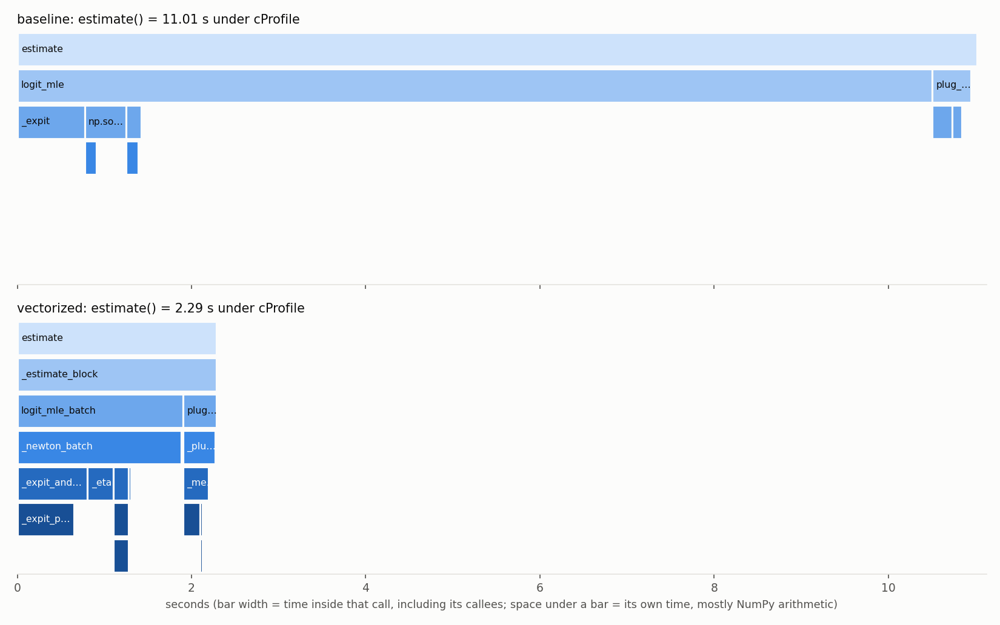
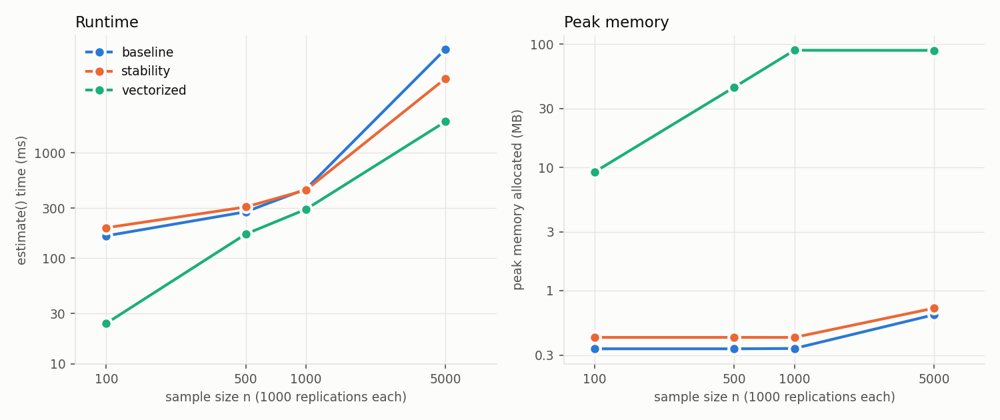
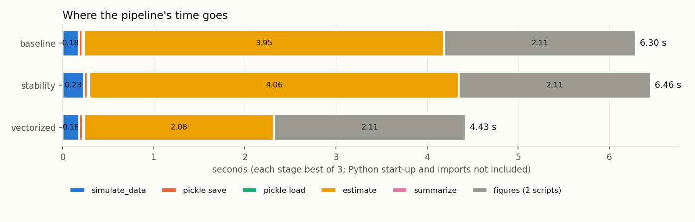

Three changes were made after the baseline in [BASELINE.md](BASELINE.md):

1. numerical-stability safeguards (§1)
2. vectorized estimation (§2)
3. parallelization (§3)

All timings were measured in one session on an Apple M1 with the study settings (n ∈ {100, 500, 1000, 5000}, S = 1000, seed 607).

## Summary

| Measure | Baseline | + Stability | + Vectorization |
|---|---|---|---|
| `estimate()` time | 1.74 s | 1.88 s | 0.77 s |
| `make all` | 5.5 s | — | 4.6 s (`make parallel`: 3.3 s) |
| Peak memory in `estimate()` | 1.4 MB | 1.6 MB | 89.5 MB |
| Stress test (n = 8–50): crashes / silent failures | 1,335 / 56 | 0 / 0 | 0 / 0 |
| Study results vs baseline | — | within 6.2e-13 | within 4.1e-13 |

---

## 1. Numerical stability

Solution implemented. At n < 50 the baseline crashed or returned garbage (BASELINE.md §4.2). Four fixes:

| Fix | Change |
|---|---|
| Overflow-safe `expit` | `exp` is only evaluated at −\|t\| ≤ 0, so it cannot overflow |
| Stable Newton weights | p(1 − p) is computed as expit(\|t\|) · expit(−\|t\|), so it no longer rounds to 0 once η > 37 |
| Failure detection | every fit gets a status (`converged`, `separated`, `singular_hessian`, `max_iter`, `nonfinite`, `fitted_boundary`), and failed fits return NaN. `analyze.py` and the plots use converged fits only. |
| Plug-in estimator and `true_delta` | 1 − α̂ is computed directly instead of by subtraction. `true_delta` raises an error instead of returning `inf`. |

Code comparison

```python
# before
def _expit(t):
    return 1.0 / (1.0 + np.exp(-t))                   # overflows at t = -800
hess = (M * (p * (1 - p))[:, None]).T @ M             # weight is 0 once eta > 37
step = np.linalg.solve(hess, grad)                    # crashes on separated data
return beta                                           # even if max_iter was hit

# after
e = np.exp(-np.abs(t)); d = 1.0 / (1.0 + e)
p, w = np.where(t >= 0, d, e * d), e * d * d          # weight stays positive
if separated_by_treatment(X, Y): status = SEPARATED   # checked before fitting
try: step = np.linalg.solve(hess, grad)
except np.linalg.LinAlgError: status = SINGULAR_HESSIAN
if max_step < tol:
    status = FITTED_BOUNDARY if np.abs(eta).max() > 30 else CONVERGED
```

Impact. In the stress test (1000 experiments per n):

| n | Before: crashes | Before: silent failures | After: converged | After: flagged, NaN |
|---|---|---|---|---|
| 8 | 685 | 21 | 279 | 721 |
| 12 | 394 | 21 | 568 | 432 |
| 16 | 150 | 8 | 831 | 169 |
| 20 | 90 | 4 | 897 | 103 |
| 30 | 15 | 2 | 983 | 17 |
| 50 | 1 | 0 | 999 | 1 |

- Floating-point events: overflow and divide-by-zero events fell to 0.
- Silent failures: before the fixes, they reached |β̂| ≈ 1e141. After them, every converged fit has |β̂| ≤ 39.
- The study itself: all 4000 fits converge and the estimates are unchanged (within 6.2e-13).

Trade-offs

- `estimate()` became 8% slower.
- `methods.py` grew from 38 to 161 lines.
- The estimates array has two new columns (status and iteration count).
- Some `max_iter` failures are really separation through Z. They are flagged, but labelled by symptom rather than cause.

---

## 2. Vectorized estimation

Solution implemented. At the study's n, the baseline spent more time on fixed per-call overhead than on arithmetic (BASELINE.md §3). All S = 1000 replications of a sample size share Z, so `logit_mle_batch` fits them in one Newton-Raphson loop:

- Batched linear algebra: the gradient and the 3×3 Hessians come from row sums, and are solved with one stacked `np.linalg.solve`.
- Finished fits drop out: each fit leaves the active arrays as soon as it is done.
- Bounded memory: rows are processed in chunks of ~10⁶ elements.

`plug_in` also accepts a whole (S, 3) array of fits. `logit_mle` is now a wrapper around the batch routine.

Code comparison

```python
# before: one fit per experiment, through the (n, 3) design matrix M
for s in range(S):
    beta, info = logit_mle(X[s], Y[s], Z, full_output=True)    # Newton loop inside:
    # grad = M.T @ (Y - p);  hess = (M * w[:, None]).T @ M;  solve(hess, grad)

# after: all experiments for one n at once
beta, info = logit_mle_batch(X, Y, Z)                          # Newton loop inside:
# g = [r.sum(1), (r * X).sum(1), r @ Z];  H[:, i, j] = row sums of w, w*X, w*Z, ...
# step = np.linalg.solve(H, g[..., None])                      # stacked solve
```

Impact

| n | Per-fit loop | Batched | Speedup |
|---|---|---|---|
| 100 | 208 ms | 17 ms | 12.0× |
| 500 | 296 ms | 60 ms | 4.9× |
| 1,000 | 369 ms | 116 ms | 3.2× |
| 5,000 | 1,032 ms | 564 ms | 1.8× |
| total | 1.88 s | 0.77 s | 2.4× |

The gain is largest at small n, where per-call overhead dominated.

Trade-offs

- Peak memory rose from 1.6 MB to 89.5 MB.
- `methods.py` grew from 161 to 269 lines, and the Hessian code is specific to the (1, X, Z) design.
- Results match single fits to rounding, not bit for bit (§6.3).

---

## 3. Parallelization

Solution implemented. `make parallel` does two things:

- It estimates with `estimate_parallel`, which runs equal-sized blocks of replications on 4 threads. NumPy releases the GIL during array arithmetic, so the threads can work at the same time.
- It runs the two figure scripts at the same time.

Code comparison

```python
# before
return np.vstack([_estimate_block(n, 0, d["X"], d["Y"], d["Z"], d["delta"]) for n, d in data.items()])

# after
with ThreadPoolExecutor(max_workers=workers) as pool:
    blocks = list(pool.map(_estimate_block, *zip(*tasks)))   # tasks: equal-sized row blocks
```

```make
# before                                      # after
$(PYTHON) results/figures/plot_plugin.py      $(PYTHON) results/figures/plot_plugin.py & pid=$$!; \
$(PYTHON) results/figures/plot_beta2.py       $(PYTHON) results/figures/plot_beta2.py; status=$$?; \
                                              wait $$pid && exit $$status
```

Impact

- Estimation: 0.76 s → 0.52 s with 4 threads (1.5×), with output identical to the serial run.
- Whole pipeline: `make parallel` takes 3.3 s, against 4.6 s for `make all`.

Trade-offs

- The GIL caps the thread speedup at 1.5×.
- Process pools were slower than serial: spawning 4 workers on macOS costs 0.8 s, more than the whole estimate.
- There is a second estimation path to maintain, though both paths share `_estimate_block`.

---

## 4. Profiler evidence

Generated by `make benchmark` (`profiling/compare_versions.py`), which runs each version's code from git in its own process.



The flame graphs share one time axis. In the baseline, about 0.95 s of `logit_mle` is not inside any function call cProfile records: it is small NumPy operations repeated over about 24,000 Newton iterations. In the vectorized version, almost all the time is arithmetic over the full arrays, mainly the logistic transform (`_expit_parts`).

| | Baseline | Vectorized |
|---|---|---|
| `estimate()` under cProfile | 1.96 s | 0.76 s |
| Function calls | 1,101,380 | 5,395 |
| `np.linalg.solve` | 24,352 calls, 0.30 s | 49 calls, 0.02 s |
| Largest own-time function | `logit_mle` 0.95 s | `_expit_parts` 0.34 s |





---

## 5. Reflections

Best return on investment

- Vectorization: about 110 lines made the dominant stage 2.4× faster.
- Overflow-safe `expit`: five lines, no measurable cost.
- Failure detection: turned 1,391 crashes and silent failures into flagged NaNs, for an 8% slowdown.

Surprises

- Per-call overhead, not arithmetic, was the baseline's cost. A 3×3 solve took 12 µs per call.
- The logistic function is still 44% of the vectorized estimate.
- The figure scripts are now the slowest stage. They take 2.67 s, mostly Python start-up and the matplotlib import. The 106 MB pickle takes only 0.05 s to save and load.
- A 2.3× faster estimate gave only a 22% faster pipeline, because the stages left untouched now dominate.
- One safeguard made things worse on its own. Stable weights alone turned crashes into silent `max_iter` failures. They only helped once failure detection was added.

Not worth the effort

- Process-based parallelism: 1.4–2.2× slower than serial.
- Batching the randomization: it would save 0.15 s but change every random draw.
- Adding random noise for stability: it hides failures instead of fixing them.
- An exact separation check: a linear program, only to relabel fits that are already flagged.
- Vectorizing the 4-iteration loops in `analyze.py` and the plot scripts.

---

## 6. Result validation

`tests/test_regression.py` runs the baseline code (commit `bd9ce33`) next to the optimized code.

### 6.1 Study results

- Data: the simulated data are identical.
- Estimates: every one matches to 1e-11 relative.
- Summary statistics: these match to 1e-10.
- Distributions: the two-sample KS statistic between the two versions' estimates is 0 at every n.
- Parallel: threaded output equals serial output.

### 6.2 Independent draws

The optimized code was also run on new randomizations of the same populations and compared with the baseline using KS and Welch tests. All 16 tests pass (p > 0.001), and the standard deviations agree within 15%. The lowest p-values (0.003–0.01, at n = 500 and 1000) come from Monte Carlo noise in the baseline's own draws: across 20 other random streams, the baseline's means are 1.4 and 2.0 standard deviations from the average. This is also why the randomization was not batched: a new random stream moves the reported bias by up to 0.03.

### 6.3 Edge cases, and why results differ

The edge-case test runs 1200 small experiments (n = 8–50) through both versions:

- 917 well-defined fits: identical estimates.
- 261 baseline crashes: NaN with a status code.
- 22 baseline silent failures: NaN with a status code.

The test also checks the converse: whenever the new code reports convergence, the baseline gave the same answer.

The new code gives different results in three ways:

1. Last-digit rounding (≤ 4.1e-13). The logistic function is computed via exp(−|t|), and the batched sums add in a different order. These differences are far below the Newton tolerance (1e-10) and the Monte Carlo error (~0.005).
2. Failed fits are NaN. By design: the baseline crashed or returned meaningless values. This never happens in the study itself.
3. Failure labels on badly conditioned fits. When the Hessian condition number reaches ~1e16, rounding can decide whether a failed fit is labelled `max_iter`, `singular_hessian` or `fitted_boundary`. It is still a failure in every version.
